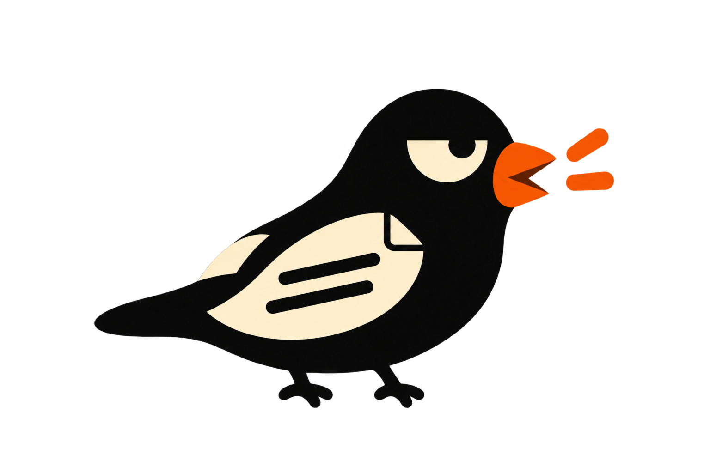

  

# QuizChirp

**Another quiz? Three left clicks. Let the bird answer.**

[简体中文](README.md) · English

QuizChirp is for repetitive, meaningless online assessments that still have to be completed, such as online tests during autumn and spring recruitment. It captures screen content, asks Codex to answer, and conveys the answer through predefined *bird calls* to evade monitoring systems.

## Applicable scenarios

The following covers **online assessments conducted within a browser**, excluding those that require a locally installed exam client, local proctoring software, or attendance at a designated physical location.

| Browser-based monitoring | How the design addresses it |
| --- | --- |
| Full-screen recording | ✅ Routine answering requires no chat window or visible answer text; feedback uses bird calls. |
| Front-facing camera recording | ✅ No need to photograph questions with a phone, look at another screen, or speak questions aloud. |
| Phone used as a second camera | ✅ Screen capture and bird-call feedback remove the need to photograph questions with a phone or consult a separate answer device. |
| Microphone recording | ✅ No need to speak questions aloud; bird calls replace spoken answers, reducing direct exposure of question and choice content. |
| Keystroke monitoring | ✅ Asking questions and collecting screenshots use only the mouse, without keyboard shortcuts such as Ctrl+C or Ctrl+V, so these actions generate no such key-combination events. |
| Tab switching / window focus detection | ✅ Routine requests require no page switching or opening of a chat window. |
| System audio recording | ✅ The number of bird calls conveys the choice without reading question or answer text aloud. |
| Mouse activity recording | ✅ Simple mouse clicks submit questions without copying text, switching to a chat window, or pasting answers. |
| Manual frame-by-frame review with magnification | ⚠️ Passing human review is not guaranteed, nor is freedom from detection or scrutiny of answering behavior. |

## Usage

**Launch QuizChirp and confirm the tray shows Ready → Use the mouse gesture on the question page → Listen for the answer**

| Scenario | What to do |
| --- | --- |
| The complete question fits on one screen | **Triple-click left** and wait for the bird-call answer. |
| The question does not fit on one screen and needs two or more views | On the first view, **hold right + triple-click left** to collect the current screen (release right once the gesture is complete). Scroll to the next view and repeat. On the final view, **triple-click left without holding right** to submit all views together, then wait for the bird calls. |

**1–6 bird calls correspond to A–F; a failure sound plays when no answer can be provided.** A–F follow the order of the choices, regardless of their original labels.

Before starting, use **Preview sounds** in the tray to learn the answer and failure sounds, and **Audio output** to choose a playback device.

Which question is answered when several are visible or a question spans multiple views?

- **Combine views before selecting a question.** Screenshots are read in submission order, joining continuations and overlapping content. A question’s text, choices, and supporting material can appear across different screenshots.
- **Select the first eligible question.** In natural reading order, choose the first single-answer question with 2–6 choices whose full text, all choices, and required material are available. The pointer only determines which screen is captured; it does not select a question.
- **Skip ineligible questions.** An incomplete question, a multiple-answer question, or one with seven choices is skipped in favor of a later eligible question. Choices are never removed to fit the limit. If no eligible question exists across the screenshots, a failure sound plays.
- **Do not switch after selection.** Only the selected question is answered, even if a later one is easier. A failure sound plays if a unique correct choice cannot be determined, no choice is correct, or multiple choices are correct.

## Quick start

1. Download the application package for your platform from [Releases](https://github.com/Circloud/QuizChirp/releases) and extract it in full.
2. On Windows, open `QuizChirp.exe`. On macOS, move `QuizChirp.app` to Applications and open it, allowing screen recording and input monitoring when prompted.
3. Follow the tray / menu bar prompts to download Codex and sign in with ChatGPT as needed. Start using the app once the status shows **Ready**.

Current builds do not use trusted publisher signing, and the macOS app is not notarized, so the first launch may encounter system security prompts.

Bird recording credits and licenses: [Audio asset notes](quizchirp/sounds/LICENSE.txt).

## Disclaimer

This project is for learning and discussion. Follow assessment rules and do not use it where external assistance is explicitly prohibited. Neither answer accuracy nor monitoring evasion is guaranteed. The Codex client runs locally, but screenshots are sent to the AI service in use; take care with sensitive information. Users assume the risks and consequences of use, and the developer accepts no responsibility for consequences arising from use or misuse.
