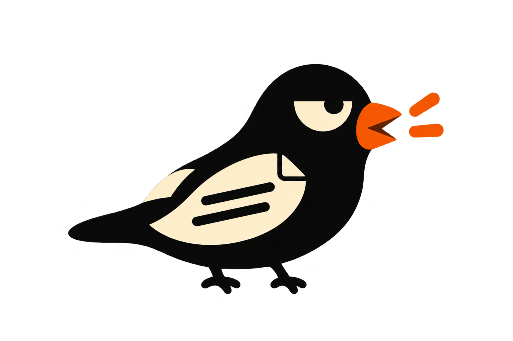

  

<h1 align="center">QuizChirp</h1>

  <strong>Another quiz? Three left clicks. Let the bird answer.</strong>

  <a href="README.md">简体中文</a> · English

  QuizChirp is for browser-based assessments such as online tests during spring and autumn recruitment. 
  It sends screenshots to Codex for answers and uses the number of bird calls to convey them and evade detection.

## Quick start

1. Download the application package for your platform from [Releases](https://github.com/Circloud/QuizChirp/releases) and extract it in full.

2. On Windows, open `QuizChirp.exe`. On macOS, move `QuizChirp.app` to Applications and open it, allowing screen recording and input monitoring when prompted.

3. QuizChirp looks for Codex on your system `PATH` and in common installation locations. It reuses the Codex sign-in it previously saved on your computer.

   - **A compatible copy is installed but wasn't found**: Select **Open configuration file** and set `codex_bin` under `[runtime]` to the path of the Codex executable. Save the file and select **Retry**.
   - **No compatible copy is installed**: Select **Download Codex**.

Current builds do not use trusted publisher signing, and the macOS app is not notarized, so the first launch may encounter system security prompts.

## Usage

1. **Check that QuizChirp is ready**: Open the app and confirm that the tray or menu bar shows **Ready**.

2. **Submit the question**: Open the assessment page.

   - **Single-screen question**: **Triple-click the left mouse button** to submit it.
   - **Question that requires scrolling**: For each view before the final one, **hold the right mouse button and triple-click the left mouse button** to save the screenshot. Release the right button after the gesture, then scroll and repeat. On the final view, **triple-click the left mouse button** on its own to submit all views together.

3. **Listen for the answer**: One to six bird calls correspond to the first through sixth choices (A–F). A failure sound plays if QuizChirp can't determine a single correct choice. Use **Preview sounds** in the tray to get familiar with the sounds.

Which question is answered when a question spans multiple views or several questions are visible?

- **Combine the views**: Codex reads the screenshots in submission order, joining continuations and overlapping content. A question's text, choices, and supporting material can appear in different screenshots. The pointer determines which display to capture.
- **Select the first eligible question in reading order**: It must be a single-answer question with 2–6 choices and include the full question, all choices, and any required material. For example, if the first question is missing choices, allows multiple answers, or has seven choices, Codex looks for the next eligible question.
- **Answer only the selected question**: A failure sound plays if no question qualifies or if Codex can't determine a single correct choice for the selected question.

## Supported assessments

QuizChirp is intended for browser-based assessments. Assessments that require an installed exam client, local proctoring software, or attendance at a designated venue are outside its scope.

## Disclaimer

This project is for learning and discussion. Follow assessment rules and do not use it where external assistance is explicitly prohibited. Neither answer accuracy nor monitoring evasion is guaranteed. The Codex client runs locally and sends screenshots to the AI service in use. Take care with sensitive information. Users assume the risks and consequences of use, and the developer accepts no responsibility for consequences arising from use or misuse.

[Audio sources and licenses](quizchirp/sounds/LICENSE.txt)
